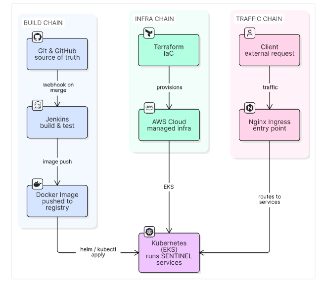

# SENTINEL — System Architecture & DevOps Toolchain

## 1. High-Level System Architecture

SENTINEL is a self-healing SRE platform: it predicts failures before they
happen, diagnoses root cause with a local LLM grounded in real runbooks, and
remediates known-safe issues automatically — with a human in the loop for
anything risky.

```
     App Deployments (K8s)
              │
              ▼
   ┌──────────────────────┐
   │     Prometheus       │──── metrics (CPU, memory, latency, error rate)
   └──────────┬───────────┘
              │
              ▼
   ┌─────────────────────┐
   │ Anomaly Detection   │──── predicts failure before it happens
   │      Model          │     (rolling z-score per metric)
   └──────────┬──────────┘
              │ alert fires
              ▼
   ┌─────────────────────┐        ┌───────────────┐
   │   Loki (logs) +     │───────▶│  LLM Agent    │
   │  Deploy History     │        │  (Ollama +    │
   └─────────────────────┘        │  RAG runbooks)│
                                  └──────┬────────┘
                                           │ diagnosis (grounded in a matched
                                           │ runbook, or withheld if none matches)
                              ┌────────────┴────────────┐
                              ▼                         ▼
                     Safe fix → auto-remediate   Risky fix → Slack approval
                     (K8s API / ArgoCD rollback)   (human clicks Approve/Deny)
                              │                         │
                              └────────────┬────────────┘
                                           ▼
                                  Grafana Dashboard
                            (full incident timeline, logged)
```

**Key design principles**
- Prediction, diagnosis, and remediation are decoupled services — each is
  independently testable and replaceable.
- The LLM runs locally (Ollama) — no external API calls, no per-token cost,
  no vendor lock-in.
- Human-in-the-loop by default: only restart / scale / rollback are
  pre-approved as safe; everything else requires explicit approval.
- Every incident produces a timestamped, auditable timeline from prediction
  through resolution.

---

## 2. Proposed DevOps Toolchain

```
┌──────────────┐     ┌──────────┐     ┌────────┐     ┌─────────────────────┐     ┌────────┐     ┌───────────┐
│ Git & GitHub │────▶│ Jenkins  │────▶│ Docker │────▶│ Kubernetes / Nginx  │────▶│  AWS   │────▶│ Terraform │
└──────────────┘     └──────────┘     └────────┘     └─────────────────────┘     └────────┘     └───────────┘
   source            CI: build,        package         orchestration +           cloud          IaC: cluster
   control            test, lint       each service     ingress / routing        hosting          & infra
                       on every                                                                   provisioned
                       commit                                                                      from code
```

### Tool Justifications

| Tool | Role | Justification |
|---|---|---|
| **Git & GitHub** | Version control, single source of truth | Every change to code and infrastructure manifests is tracked, reviewable, and reversible. Also the foundation for GitOps — downstream tooling watches this repo instead of being told what to do by hand. |
| **Jenkins** | CI — build, test, lint on every commit | Automates verification on every push/PR so broken code never reaches a deployable artifact. Self-hosted, so pipelines can be customized freely (e.g. running against a private Ollama/model cache) without depending on a third-party runner. |
| **Docker** | Containerize each microservice | Packages the predictor, diagnosis-agent, remediator, and api services (plus dependencies) into consistent, portable images — eliminates "works on my machine" drift between dev, CI, and production. |
| **Kubernetes / Nginx** | Container orchestration + ingress | Kubernetes runs and scales each service, restarts failed pods, and is the same API surface SENTINEL's remediator acts on (restart/scale). Nginx provides a stable ingress layer for external traffic (Slack approval webhooks, the Grafana dashboard) instead of ad-hoc port-forwarding. |
| **AWS** | Cloud hosting for the cluster | Provides durable, scalable infrastructure (e.g. EKS) beyond a local/dev cluster — necessary once the platform needs to run continuously and handle real production load rather than a laptop demo. |
| **Terraform** | Infrastructure as Code | Makes the entire cluster and supporting cloud infrastructure reproducible from version-controlled configuration — no manual console clicks, disaster recovery is just `terraform apply`. |

---

## 3. Cluster Topology (Build / Infra / Traffic Chains)

The linear chain above is one way to read the toolchain; the more accurate
picture is three independent chains that all converge on the same
Kubernetes cluster:



**The corrected relationship to call out explicitly:** Nginx Ingress sits
*in front of* the cluster and routes traffic *into* it — it is the entry
point, not something the cluster forwards traffic to. (An earlier draft of
this diagram had that arrow backwards; the direction matters because Nginx
Ingress runs as pods *inside* the cluster it fronts.)

| Chain | Flow | What it proves |
|---|---|---|
| **Build** | Git & GitHub → Jenkins → Docker Image → cluster | Code becomes a running, versioned container with no manual step |
| **Infra** | Terraform → AWS Cloud → EKS → cluster | The cluster itself is reproducible from code, not hand-provisioned |
| **Traffic** | Client → Nginx Ingress → cluster | External requests reach services through one stable, routable entry point |

### Node Justifications

| Node | Chain | Justification |
|---|---|---|
| **Git & GitHub** | Build | Single source of truth for code — the webhook that kicks off Jenkins on every merge, so nothing deploys that wasn't reviewed and committed. |
| **Jenkins** | Build | Runs build and test on every push; a failing test blocks the image from ever being built, so broken code can't reach the registry. |
| **Docker Image** | Build | Packages a service and its dependencies into one portable, versioned artifact — identical in dev, CI, and production. |
| **Terraform** | Infra | Defines the cloud infrastructure as code, so the cluster's exact configuration is reviewable in Git and reproducible from scratch, not hand-clicked in a console. |
| **AWS Cloud** | Infra | Hosts the managed infrastructure durably — persistent, scalable compute that a local cluster can't offer for continuous production load. |
| **Client** | Traffic | The real-world source of load the system has to serve — the reason an ingress layer exists at all. |
| **Nginx Ingress** | Traffic | Terminates external traffic at one stable entry point and routes it to the right internal service, instead of exposing pods directly. |
| **Kubernetes Cluster (EKS)** | Convergence | The one place all three chains land — runs the containers Docker built, sits on the infrastructure Terraform/AWS provisioned, and is what Nginx routes traffic into. |

---

## 4. Bonus: Current Implementation Progress

The chain above is the production-target proposal. Ahead of schedule, a
working local version of the same pipeline shape is already running, using
lightweight equivalents for the CI runner and cloud target:

```
┌──────────────┐
│ Git & GitHub │  single source of truth
│              │  (code + infra/k8s manifests)
└──────┬───────┘
       │
       ├─────────────────────────────┐
       ▼                             ▼
┌─────────────────────┐     ┌─────────────────────────┐
│ GitHub Actions (CI)  │     │ ArgoCD                   │
│ verify → test →      │     │ watches infra/k8s path,  │
│ build image          │     │ directly from Git — NOT  │
└──────┬───────────────┘     │ fed by CI or Docker/GHCR │
       ▼                     └──────────┬───────────────┘
┌─────────────────────┐                 │
│ Docker / GHCR         │                 │
│ (image build +        │                 │
│  registry, tagged     │                 │
│  by commit SHA)        │                 │
└──────┬─────────────────┘                 │
       │  image pulled at pod start        │  manifests applied
       │                                   ▼
       │                          ┌─────────────────────┐
       └─────────────────────────▶│ Kubernetes (Kind)     │
                                   │ SENTINEL services      │
                                   └──────────▲──────────┘
                                              │
                                   ┌──────────┴──────────┐
                                   │ Terraform              │
                                   │ provisions the Kind    │
                                   │ cluster — independent  │
                                   │ of CI, runs before/    │
                                   │ alongside it            │
                                   └─────────────────────────┘
```

| Reference tool | What's actually running | Why |
|---|---|---|
| Jenkins | GitHub Actions ([.github/workflows/ci.yml](../.github/workflows/ci.yml)) | Same CI role (verify → test → build), zero self-hosted runner maintenance |
| AWS (EKS) | Kind, provisioned via Terraform ([infra/terraform](../infra/terraform)) | Same Terraform-owns-cluster-lifecycle pattern; swappable for an AWS module later |
| Nginx | *(not yet configured)* — services reached via `kubectl port-forward` | Next gap to close before a non-local deployment |
| — | ArgoCD ([infra/argocd](../infra/argocd)) | Not in the reference chain, but applies manifests to Kubernetes for full GitOps (no manual `kubectl apply`) |

Moving from this to the full proposed chain is additive, not a redesign:
swap the Terraform module target (Kind → EKS) and the CI runner (GitHub
Actions → Jenkins), and add an Nginx ingress controller.
